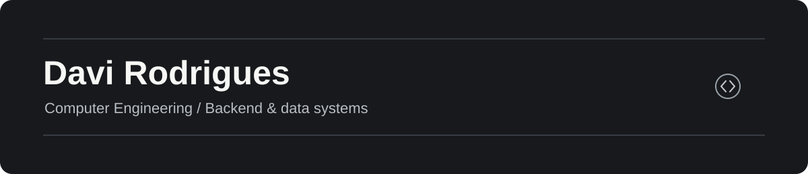

### Hi, I'm Davi.

I'm a Computer Engineering student at Mackenzie University in São Paulo, Brazil. I build personal projects around backend development, integrations and data, with a growing focus on **Java and Spring Boot**.

---

## Featured project

**Alexa + Gemini · conversational voice prototype**  
I built an Alexa skill with Python and AWS Lambda that answers questions through Gemini and supports follow-up turns. I worked through response serialization and session context to make the interaction flow.

[Watch the demo on LinkedIn ↗](https://www.linkedin.com/feed/update/urn:li:activity:7364760890564399105/) · [Read the engineering case study →](./projects/alexa-gemini.md)

**More work:** [Product Recommendation API](https://github.com/DaviRodrigues06/product-recommendation-api) *(Java/Spring Boot · in progress)* · [SQL Lab](https://github.com/DaviRodrigues06/sql-lab-livraria) *(relational modeling)* · [Java OOP exercises](https://github.com/DaviRodrigues06/POO---Mackenzie-) *(learning archive)*

---

## Tools I use and study

    

## Now

I'm building a Java backend project that others can clone, run and evaluate through its domain rules, database, tests and documentation. I'm interested in junior backend opportunities and learning from people who ship reliable software.

Projects here are personal work and use fictional data. I label work in progress.
