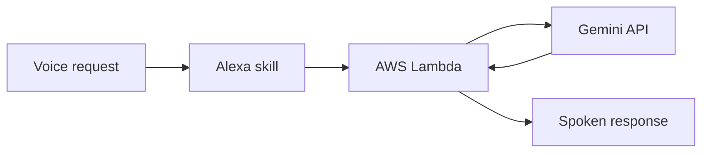

# Alexa + Gemini — a conversational voice prototype

**Independent project · Python · AWS Lambda · Alexa Skills Kit · Gemini API**

I built an Alexa skill that sends a spoken question to Gemini and reads back a useful answer. The prototype supports a single question and a conversational mode with follow-up questions. My goal was to learn how a voice interface, a serverless function and a language model fit together in a working interaction.

## How it works

The Lambda function receives the intent and conversation context, requests an answer from Gemini, extracts the text needed by Alexa's response builder and stores conversational state in session attributes for the next turn.

## The engineering problem

My first attempts passed a Gemini response object into Alexa's response serialization, which failed because the SDK expected serializable content. I changed the boundary between the services: the skill now keeps the response as plain text in session attributes and constructs Alexa responses from that text. I also had to account for response time limits while testing longer exchanges.

## What I learned

- Convert third-party SDK objects into the simple types expected by the next service.
- Keep conversational state explicit across requests.
- Test the whole interaction, including a follow-up question, rather than only the first API call.
- Consider latency and persistence costs before adding infrastructure.

**Evidence:** I have a LinkedIn post demonstrating the prototype. I will add the direct link here after verifying it. The source code is not currently linked from this case study.

This is a personal prototype, not a production voice assistant.
